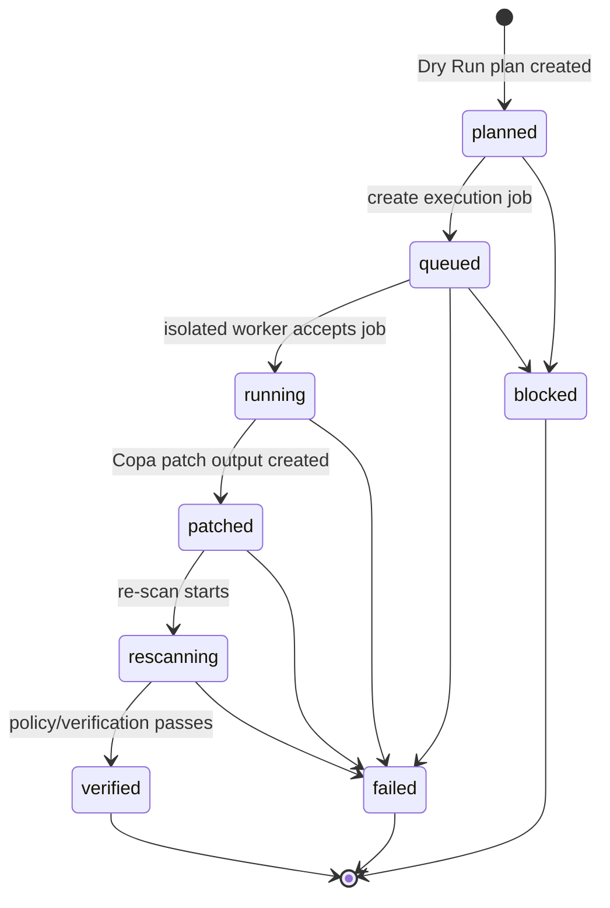

# Remediation Worker Contract

**Durum:** Faz 4 tamamlandı. Gerçek izole worker bağlandı; Copa execution, immutable
registry push, yeniden tarama ve HMAC imzalı evidence callback'i uçtan uca çalıştırıldı
(`RM-EXEC-0001`, `RM-EXEC-0002`). Doğrulanmış çıktının kontrollü publish akışı da
tamamlandı (`PUB-0003` = `Published`). Worker dispatch hâlâ manuel tetiklenir; SSI
tarafında otomatik dispatch endpointi yoktur.

## Amaç

SSI web/API katmanı remediation sürecini planlar, izler ve denetim kaydı tutar. Image
pull, Copacetic patch, registry push ve yeniden tarama ise ayrı bir **izole worker**
tarafından yapılmalıdır. Böylece kullanıcı arayüzünü sunan container'a Docker socket,
BuildKit yetkisi veya Harbor'a yazma yetkisi verilmez.

Bu ayrım özellikle shared PoC/production ortamında kritik bir güvenlik sınırıdır:
web uygulamasındaki bir hata, doğrudan registry'e image yazma veya host Docker erişimi
sağlamaz.

## Uygulanan Job Lifecycle



Mevcut backend bu durum makinesini ve geçiş kurallarını uygular. `dry-run` job'ı
`planned` veya `blocked` durumunda kalır; gerçek execution job'ı ise yalnızca ayrı bir
worker altyapısı bulunduğunda `queued` durumuna oluşturulabilir. Bu sprintte worker
dispatch endpointi özellikle eklenmemiştir. Buna karşılık canonical report'u kabul edilmiş
ve planlanabilir OS package güncellemesi olan bir Dry Run, salt-okunur worker handoff
manifesti olarak indirilebilir. Faz 4'te bu boşluk dispatch eklenerek değil, ters
yönde kapatıldı: worker'ı manuel tetiklenen pipeline başlatır, execution job'ı ise
SSI'ya dönen HMAC imzalı evidence callback'i ile oluşur.

## Worker Input Sınırı

Worker'a yalnızca aşağıdaki credential-free sözleşme ile iş verilmelidir:

```json
{
  "contractVersion": "ssi.remediation-worker/v1alpha1",
  "job": { "id": "RM-EXEC-0001", "parentJobId": "RM-DRY-0001" },
  "source": {
    "image": "harbor.example.com/project/payment-api:1.2.3",
    "digest": "sha256:<immutable-source-digest>",
    "immutableReference": "harbor.example.com/project/payment-api@sha256:<immutable-source-digest>"
  },
  "scanner": {
    "tool": "trivy",
    "report": "canonical-trivy.json",
    "scope": "os-packages-only"
  },
  "remediation": {
    "engine": "copacetic",
    "outputReference": "harbor.example.com/project/payment-api:1.2.3-copa-r1"
  },
  "verification": {
    "reScanPatchedDigest": true,
    "blockPublishUntilVerified": true
  },
  "credentialDelivery": {
    "mode": "worker-runtime-secret",
    "includedInPayload": false
  }
}
```

Harbor robot secret, registry token veya Docker config bu payload içinde **asla** yer
almaz. Bunlar yalnızca worker'ın runtime secret store/CI credential mekanizmasından
alınmalıdır.

## Prepare-only Handoff Manifest

`GET /api/v1/remediation/{jobId}/worker-handoff` yalnızca aşağıdaki koşulları geçen
bir `dry-run` job için `200` döner:

- lifecycle `planned`,
- immutable source `sha256` digest,
- source digest ile eşleşen, doğrulanmış OS-only canonical Trivy receipt,
- en az bir planlanabilir OS package güncellemesi.

Manifest worker'a iş göndermeyi değil, worker'ın daha sonra güvenilir job artifact'ından
alacağı canonical JSON'u hangi content digest ile doğrulayacağını, source ve proposed
output referansını, package planını ve zorunlu verify gate'i kaydeder. `executionMode`
değeri `prepare-only` kalır. Ham Trivy JSON, Harbor robot credential'i, Docker config,
Docker socket bilgisi ve `publishAllowed: true` bu manifestte bulunmaz.

Bu endpoint koşullar sağlanmadığında `409` döner. Bu durum bir hata gizleme değil;
yanlış veya eksik scanner input'unun izole worker'a devredilmesini engelleyen bir
kontroldür.

## Worker'ın Uyguladığı Kontrollü Akış

1. Source image, tag yerine immutable digest ile pinlenir.
2. Worker canonical input'u güvenilir job artifact'inden alır, handoff'taki content
   digest ile doğrular ve gerekirse aynı immutable source digest için yeniden
   `trivy image --pkg-types os --ignore-unfixed --format json` üretir.
3. Yalnızca `os-pkgs` kapsamındaki bulgular Copa'ya verilir. Application dependency,
   class'ı belirsiz bulgu ve Wolfi/Chainguard hedefleri ilk fazda otomatik patch'e
   sokulmaz.
4. Copa patch sonucu ayrı output tag/digest olarak üretilir; kaynak image değiştirilmez.
5. Output digest yeniden Trivy ile taranır. `before/after` severity, fixed ve remaining
   CVE listeleri worker sonucu ile kaydedilir.
6. Policy gate doğrulama tamamlanmadan Harbor publish yapılmaz.

## Readiness Kontrolü

`GET /api/v1/remediation/{jobId}/execution-readiness` salt-okunur bir endpointtir.
Örnek kontroller:

- uygun `os-pkgs` remediation planı,
- immutable source digest,
- canonical raw Trivy JSON,
- credential-free handoff manifest,
- izole worker'ın SSI'dan başlatılabilmesi (Azure DevOps Copa pipeline'ı ayarlı).

Hepsi sağlanınca `ready` ve `dispatchAllowed` `true` olur. Azure DevOps otomasyonu kapalıysa
son madde `Waiting` kalır; worker pipeline'ı handoff manifest ile Azure DevOps'ta elle çalıştırılır.
Re-scan/verification gate ve registry output sınırları listede yer almaz: worker bunları her
çalışmada uygular (Copa çıktısı `approved/` altına yazılamaz) ve iş yalnızca doğrulanmış
kanıtla ilerler. UI bu yüzden gerçek bir patch yapılmış gibi davranmaz.

## Manual Worker Preflight

`azure-pipelines-remediation-worker-preflight.yml` manuel çalışan, yalnızca teknik
hazırlığı kaydeden bir Azure DevOps pipeline'idir. Source image digest'i ve SSI intake'in
ürettiği canonical receipt `contentDigest` parametre olarak istenir; ham report veya
registry secret pipeline artifact'ine yazılmaz. Bu digest ham dosya byte hash'i değil,
SSI'nin parse edilmiş canonical JSON üzerinde hesapladığı doğrulama değeridir.

Preflight aşağıdakileri kontrol eder:

- Docker runtime, Docker Buildx ve mevcut BuildKit inspect bilgisi,
- pre-provisioned, pinlenmiş Copa executable ve beklenen `0.14.2` sürümü,
- Harbor HTTPS CA trust'i (`curl -k`/TLS bypass kullanılmaz),
- Harbor robot credential'inin runtime'da mevcut olup olmadığı,
- immutable source ve canonical receipt content digest formatları.

Bu pipeline **patch, push, publish veya re-scan yapmaz**. Sonuç artifact'i teknik
hazırlığı `ready-for-isolated-worker` veya `blocked` olarak gösterir; `executionAuthorized`
her zaman `false` kalır. Gerçek execution için ayrı least-privilege worker pool,
korumalı environment/approval ve target repository publish policy gerekir. Harbor TLS
tarafında ek bir işlem çıkmadı: Faz 4'te çalıştırılan remediation ve publish worker'ları
Harbor sertifikasını sistem CA bundle'ı ile doğruladı, worker trust store'a CA
eklenmedi. Bu ayrım, shared `LinuxPool` üzerinde yanlışlıkla registry mutation
yapılmasını önler.

## Faz 4 Uçtan Uca Çalıştırma Kanıtı

Bu sözleşme gerçek altyapıda çalıştırıldı; PoC iddialarının dayanağı aşağıdaki
kayıtlardır.

- **Callback rotası:** Run `#20260728.1`, `LinuxAgent2` / `build-agent-01`, kaynak
  `10.0.0.30` → hedef `10.0.0.10:5021`, health check `HTTP 200`.
- **Copa execution ve immutable push:** `RM-EXEC-0001` ve `RM-EXEC-0002`. Patch çıktısı
  ayrı bir output digest olarak üretildi, kaynak imaj değiştirilmedi.
- **Yeniden tarama:** `RM-EXEC-0002` canonical OS kapsamında `431 → 0`. `RM-EXEC-0001`
  için tam imaj taraması `432 → 0` verdi; `RM-EXEC-0002` çalışmasında SSI Harbor scan
  verisine ulaşamadığı için tam imaj taraması `Not available` göründü (bekleyen kalem).
- **Evidence callback:** HMAC imzalı ve tekrar oynatmaya karşı korumalı. `RM-EXEC-0002`
  output digest
  `sha256:0c70cf19148be231e3b0f62d3ec15b9033a618cb4257737d35863759863db51a`, evidence
  digest `sha256:6340f40b672b41d9dce80d03207275d32e1405a7499e4e4ad5f639a051f17f1f`.
- **Kontrollü publish:** `PUB-0003` = `Published`, 12/12 politika kontrolü `pass`,
  isteyen ve onaylayan kimlikler ayrı.

Bilinerek açık bırakılan sınırlar: worker dispatch manuel tetiklenir, worker shared
`LinuxPool` üzerinde koşar (ayrı least-privilege pool bekleniyor), firewall kuralı tek
kaynak IP'ye bağlıdır, job store `memory` modundadır (restart iş zincirini siler) ve
uygulama bağımlılıkları remediation kapsamı dışındadır.

## Uygulama Notları

- Web/API service'in Docker socket mount'u olmayacak.
- Worker service ayrı identity, ayrı network policy ve minimum Harbor repo yetkisiyle
  çalışacak.
- Worker yalnızca target project/repository'e yazabilmeli; source repository ve
  publish işlemi için ayrı policy/approval uygulanmalı.
- İş sonucu idempotent olmalı: aynı source digest + plan için tekrar çalıştırma aynı
  output reference/digest kontrolünü yapmalı, sessizce yeni image üretmemeli.
- Worker logları ve state geçişleri `lifecycleEvents` olarak denetlenebilir biçimde
  saklanmalı; secret içeren ham loglar API'ye dönülmemeli.

## Resmi Teknik Referanslar

- [Copacetic Quick Start](https://project-copacetic.github.io/copacetic/website/quick-start)
- [Copacetic Introduction](https://project-copacetic.github.io/copacetic/website/introduction)
- [Trivy JSON reporting](https://trivy.dev/docs/latest/configuration/reporting/)
- [Trivy vulnerability scanning](https://trivy.dev/docs/latest/scanner/vulnerability/)
